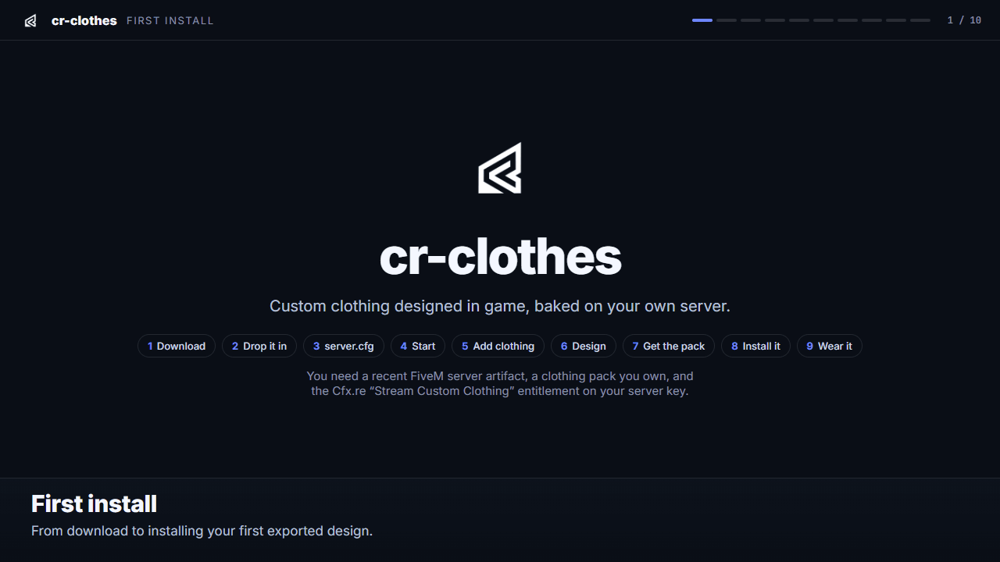

# cr-clothes

**Custom clothing designed in game, baked on your own server, delivered to your
Discord. Free, open source, and entirely self-contained.**

<p align="center">
  <a href="https://cody-raves.github.io/cr-clothes/first-install/"></a>
  <br>
  <sub>The <a href="https://cody-raves.github.io/cr-clothes/first-install/">interactive version</a> lets you step through at your own pace.</sub>
</p>

Players open a designer on their own character and paint a garment on its real
UV map with a live 3D preview. Your server bakes the design into a proper
clothing resource and posts a download link to your Discord. Drop the pack into
`resources/`, restart, wear it.

No website. No outside bake service. No account. No store in the middle.

---

## Why this exists

Custom clothing tools for FiveM are usually services: you design on someone
else's website, their servers do the baking and packing, a particular store is
required to sell anything, and the service keeps a share of each sale.

cr-clothes turns each of those around.

| | A typical hosted service | cr-clothes |
|---|---|---|
| Where players design | a website | **in game, on their own character** |
| Where the baking and packing happens | the service's servers | **your server** |
| What you depend on | their uptime, their account system | **nothing outside your server** |
| Selling to players | their store integration, required | **optional — any store, or none** |
| Share of your sales | a percentage | **none** |
| Source code | closed | **open — all of it is in this repo** |

- **Nothing is hidden.** The texture baker, the mesh reader, the pack builder,
  the preview renderer and the Discord delivery are all here, readable, and
  yours to change.
- **Nothing sits in the middle.** Your server creates the content and your
  Discord receives it. There is no marketplace to list on and no portal to log
  in to.
- **Nobody takes a cut.** If you choose to sell design rights, you sell them on
  your own store at your own price and keep all of it. cr-clothes has no
  revenue share because it has nowhere to put one.
- **You bring the clothing.** cr-clothes ships with no garments. Drop clothing
  packs you own into a folder, run one command, and they become designable —
  the 3D previews are read straight from your packs, with no other tools.

---

## How it works

```
   in game                      your server                     your Discord
  ┌───────────────────┐      ┌──────────────────┐           ┌──────────────────┐
  │ paint on the      │      │ bake the design  │           │ 3D preview       │
  │ garment's real    │─────▶│ into the texture,│──────────▶│ + download link  │
  │ UV map, live 3D   │      │ build the pack   │   link    │ back to your     │
  │ preview           │      │                  │           │ own server       │
  └───────────────────┘      └──────────────────┘           └──────────────────┘
                                                                     │
                                                                     ▼
                                                        drop into resources/, restart
```

The baker and the mesh reader are pure JavaScript with no native dependencies,
so they run anywhere FiveM runs — including hosted servers where the resource
folder is read-only.

---

## Quick start

1. Copy `cr-clothes/` into your server's `resources/` folder.
2. Add to `server.cfg`:

   ```cfg
   ensure cr-clothes
   add_ace group.admin command.clothbuilder allow
   add_ace group.admin crclothes.admin allow

   set clothdesigner_webhook_url "https://discord.com/api/webhooks/..."
   set clothdesigner_public_url  "http://YOUR.SERVER.IP:PORT"
   ```

3. Put a clothing pack you own into `cr-clothes/garments/` and run
   `crclothes_prepare` in the server console, then `refresh` and
   `restart cr-clothes`.
4. In game: `/clothdesigner` → pick a garment → design → **Export clothing
   pack**.
5. The link arrives in Discord. Install the pack like any clothing resource.

The [interactive first-install walkthrough](https://cody-raves.github.io/cr-clothes/first-install/)
shows these steps one screen at a time.

The full walkthrough — delivery options, permissions, hosted servers,
troubleshooting — is in **[docs/ADMIN-GUIDE.md](docs/ADMIN-GUIDE.md)**.

Streaming custom clothing needs the Cfx.re "Stream Custom Clothing"
entitlement on your server key, as with any clothing pack. The resource also
needs a FiveM artifact with the Node 22 runtime.

---

## Who may design, and selling (optional)

By default admins can design and everyone else needs a *design right*. Set
`Config.OpenDesign = true` and it is a free creative tool for the whole server.

Design rights can be handed to a player, a job or a gang:

```
crclothes_grant job:police * -1        the police design their own uniforms
crclothes_grant gang:ballas * -1       a gang designs crew clothing
crclothes_grant 12 * 5                 five designs for one player
```

If you *want* to charge for them, any store that can run a console command
works. With Tebex it is one line in a package:

```
crclothes_grant {id} * 1
```

No API keys, no webhooks, no account linking, and nothing is required of you if
you would rather not sell anything. Details:
[cr-clothes/TEBEX.md](cr-clothes/TEBEX.md).

Works with Qbox, qb-core, ESX, or no framework.

---

## Status

Proven on live servers:

- In-game designer: fill, text, freehand drawing and image layers on the real
  UV map, with a live 3D preview
- Texture baking into valid GTA texture dictionaries, on the game server
- Complete installable clothing packs, as built up to version 1.0.0
- Discord delivery by webhook, with the pack never leaving your server
- Works on hosted servers with a read-only resource folder

Newer, and less battle-tested:

- Preparing your own clothing packs with `crclothes_prepare`, including 3D
  previews read from the packs themselves
- Design rights with jobs, gangs and store purchases

New in 1.1.0 and not yet tested in the game:

- Every design on clothing exporting as a new clothing item of its own,
  beside the garment it was drawn on. This is now what an export builds for
  everything but props. The packs have been checked offline only; none has
  been loaded in the game yet. Try one on a test server before installing
  packs on a live one.

Known limits are listed at the end of the
[admin guide](docs/ADMIN-GUIDE.md#known-limits). Read the first two before
installing many designs: the new packs are untested in the game, and each
installed pack uses one of a small number of clothing collection slots on the
player model.

---

## Repository layout

```
cr-clothes/             the FiveM resource — this is what you install
  builder/              texture baker, mesh reader, pack builder, delivery
  web/                  the in-game designer
  garments/             drop your clothing packs here
  grants.lua            design rights (players, jobs, gangs, purchases)
  bridge/framework.lua  framework adapter
clothdesigner-bot/      optional Discord bot, if you prefer it to a webhook
docs/ADMIN-GUIDE.md     setup and day-to-day use
docs/                   also the project site, as GitHub Pages serves it (generated)
site/                   source of the project site
```

Apart from the Markdown files at its top level, everything in `docs/` is
generated: it is the site at <https://cody-raves.github.io/cr-clothes/>, built
from `site/` with `node site/build.js`. Change the source in `site/`, not the
files in `docs/`.

---

## A note on assets

This repository contains no game assets and no clothing. You supply your own:
clothing you made, commissioned, or bought with the right to modify it.

---

## License

[MIT](LICENSE). Use it, change it, ship it on your server, build on it.

---

## Credits

Built by [@cody-raves](https://github.com/cody-raves). The `.ydd` mesh reader
was written from the file-format knowledge documented by the
[CodeWalker](https://github.com/dexyfex/CodeWalker) project; no CodeWalker code
is included or required. The `.ymt` writer, which describes each exported item
to the game, was written from the format as documented by CodeWalker and by
RageLib (part of gta-toolkit); no code from either is included.

Issues and pull requests are welcome — that is the point.
